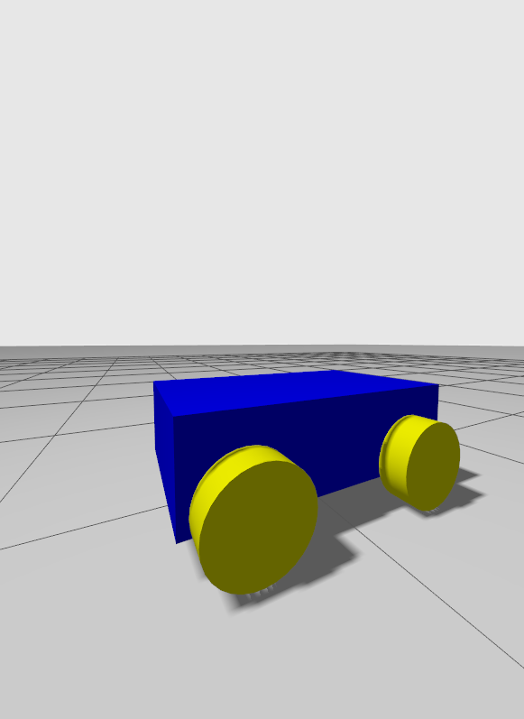

## Information about this repository

This project will allow a user to interact with a robot using an interface designed by myself in a manner that is more user-friendly than conventional human-robot interaction.

## Images of The Project

Picture of Little Henry The Robot - 4 wheel mobile robot shown in Gazebo, made using a URDF model.

Below is a screenshot showing the HRI Interface and a possible command for Henry to carry out.

## All Software Artefacts are stored in the src directory

## Installation and Set-up Process
My project uses Ubuntu 22.04.4

1. Install ROS2 Humble and set-up:
https://www.youtube.com/watch?v=0aPbWsyENA8

Make sure you put the command to source the ROS enivornment in your ./bashrc file

2. Install Gazebo Fortress using ROS:
https://gazebosim.org/docs/fortress/ros_installation

3. Set up OpenAI API:
Create an OpenAI account and go to:
https://platform.openai.com

OpenAI's API is not free to use and as such you will have to put in a small amount of money into your personal wallet in order to use it by generating a project key and therefore in order to run my system.

It is possible for me to add users to my organisation who will be able to access the API through my own personal project key, however because I do not know who exactly will be trying to use my software artefacts I cannot add anyone to my organisation.

Once you have added money to your wallet and generated a project key. 

Set your project key in your enviornment:
export OPENAI_API_KEY='your-project-key'

You can also write this line in the bottom of your ./bashrc file to keep it persistent.

4. Create a ROS2 Workspace:
https://www.youtube.com/watch?v=3GbrKQ7G2P0

5. Put my src folder into your ROS2 workspace

## Running the Software Artefacts:

1. run "colcon build" in the terminal to build everything.
2. run "source ~/. bashrc" in the terminal - to source the ./bashrc file
3. run "ros2 run henry_model_pkg start_hri" in the terminal to start the TKinter HRI Interface
4. In another terminal repeat lines 1 and 2 before running "ros2 launch henry_model_pkg henry_sim.launch.py" to start the simulation and the ros_ign_bridge.

## Important things to note:

1. You can send as many requests to Henry the Robot that it cannot do as you want, without closing the Tkinter window.

2. You can send one actionable request to Henry that it will perform, if you send another one
without re-running the HRI interface - Henry will act strangely and slow in the simulation.

3. If you want to send another actionable request to Henry, close the TKinter window and re-run the HRI command from step 3 in "Running the Software Artefacts" - Henry will now execute the request without acting strangely. Keep doing this everytime you want to send another actionable request

